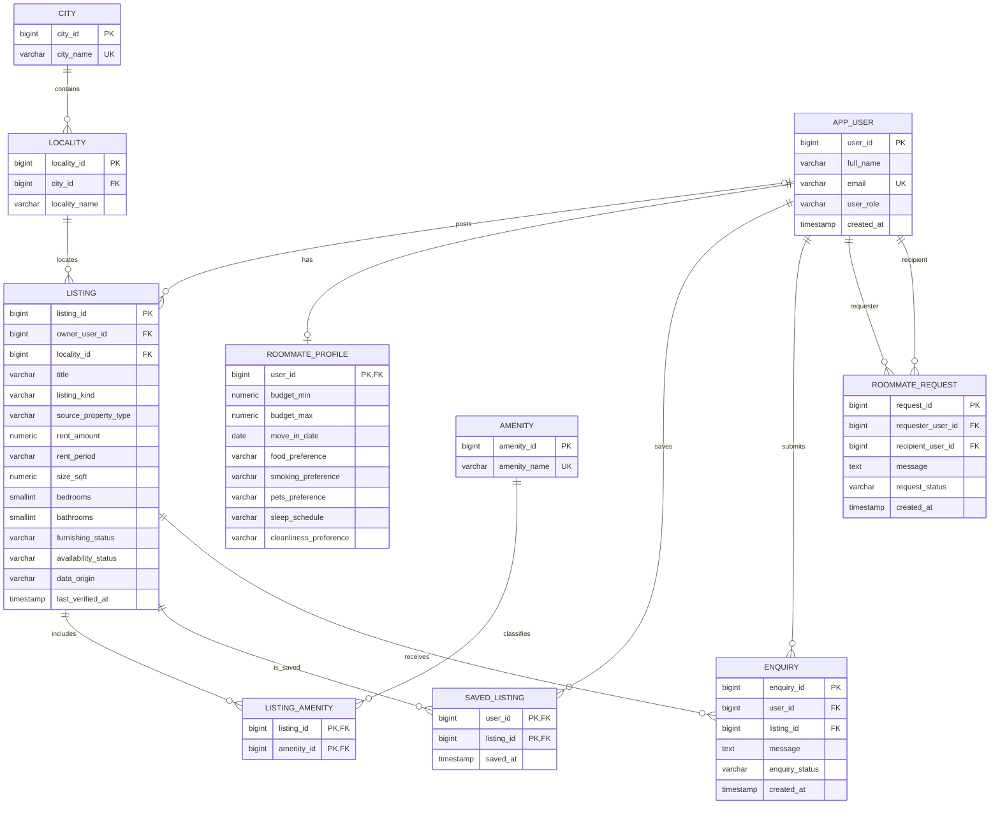

# SaathSpace — Phase 2 Draft ER Model

**Status:** First-pass proposal to review before creating production DDL.

## Core design principle

The source CSVs describe advertised rental units, not a property directory with verified room-level inventory. To keep the DBMS scope manageable and make the imported data fit, the MVP uses one `listings` entity for an advertised rental unit/room. A listing can be an entire home, private room, shared room, or PG/hostel entry. The imported dataset will be labelled as historical/unverified; owner-created demo listings can represent current availability in the application.

## ER diagram

> The diagram is intentionally a draft. SQL `CHECK` constraints, unique constraints and exact nullable rules will be recorded in the schema specification before implementation.

## Table responsibilities

| Table | Purpose | Important rule |
|---|---|---|
| `app_user` | Application accounts and roles | Unique email; store password hashes only when authentication is implemented |
| `city` | Supported cities | Unique city name |
| `locality` | Neighbourhood/locality belonging to a city | Unique locality name within a city |
| `listing` | One advertised rental unit/room | Positive rent; source and freshness tracked separately from availability |
| `amenity` | Standard amenity dictionary | Unique amenity name |
| `listing_amenity` | Many-to-many bridge between listings and amenities | Composite primary key prevents duplicate amenity assignments |
| `roommate_profile` | One user's matching preferences | One profile per user; `budget_min <= budget_max` |
| `saved_listing` | User's saved listings | Composite primary key prevents saving the same listing twice |
| `enquiry` | Interest in a listing | Status is constrained to a known set |
| `roommate_request` | A request to connect with another potential roommate | Requester and recipient must differ; status is constrained |

## Roommate matching: keep it simple and explainable

The initial match score should be calculated from profile data, not generated by AI. A possible first version compares budget compatibility, preferred city/location, move-in timing, and selected lifestyle preferences. The exact weights should be documented and visible in the UI. The score is derived data, so we do not need a separate `match_score` table for the first version; `roommate_request` stores a user's decision to connect.

## Listing fields and public-data handling

The imported fields map roughly as follows:

- `city` -> `city` / `city_id`
- `location` -> `locality` / `locality_id`
- `house_type` -> `source_property_type` and, only where confidently mapped, `listing_kind`
- `house_size` -> parsed numeric `size_sqft`
- `price` -> numeric `rent_amount` after validation
- `numBathrooms` -> `bathrooms`
- `Status` -> standardized `furnishing_status`
- `description` -> `description`
- `latitude`, `longitude` -> optional coordinates if retained in `listing`
- `verificationDate` -> raw source metadata only; do not turn relative labels into fabricated dates
- `priceSqFt` -> excluded from the cleaned operational model because it is entirely null in the archive

The original imported row should first go into `stg_rental_listings`, preserving raw values and source filename/row number. Cleaned rows can then be transformed into the operational tables.

For public-dataset records, use `data_origin = 'public_dataset'` and an availability value like `unverified` until the listing is independently checked. Only verified/manual or explicitly synthetic demo listings should be shown as currently available. Don't represent generated profiles as actual people.

## Important constraints to implement

- `rent_amount > 0` when present.
- `size_sqft > 0` when present.
- `budget_min >= 0`, `budget_max >= 0`, and `budget_min <= budget_max`.
- `city.city_name` unique.
- `(locality.city_id, locality.locality_name)` unique.
- `amenity.amenity_name` unique.
- Primary keys on all tables; foreign keys for every relationship.
- Composite primary keys for `listing_amenity` and `saved_listing`.
- Disallow a roommate request from a user to themselves.
- Restrict listing, enquiry, and roommate-request status fields to documented values.

## Deliberately excluded from the first ERD

Payments, chat messages, bookings/leases, identity verification, landlord organizations, and AI recommendation tables. Add them only if the course requirements or team capacity justify them.

## Next step

Review this ERD against the assignment brief, then create the first SQL scripts: database/schema setup, staging table, and core table DDL with primary keys, foreign keys and checks. The staging import can be tested independently from the application schema.
